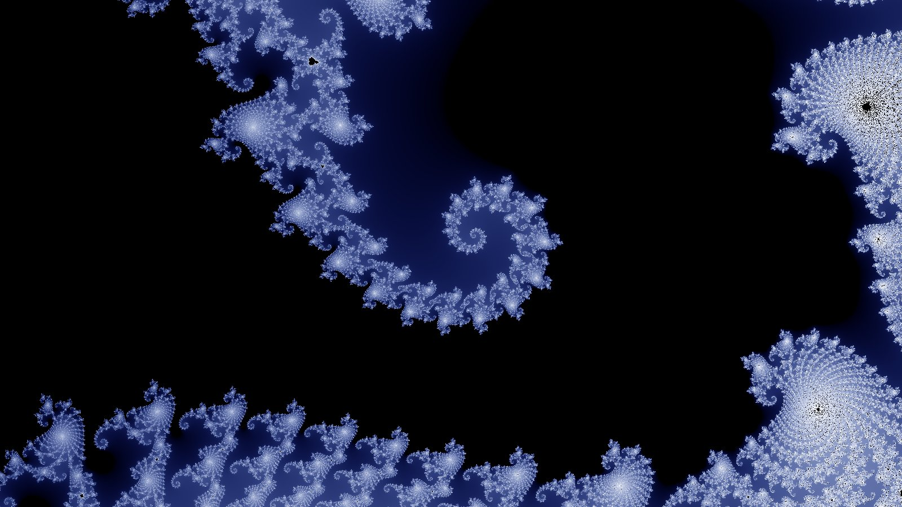

# The Opening — visual references

> A look book for the Opening (Gen 1:1–2:7, 5:07, [treatment v3.6](../../story/arcs/01-beginnings/opening/TREATMENT.md)). One section per beat, in the treatment's order and times. Started 2026-10-13, at your request ("You should start a page of visual references for the animatic"). It serves the [production plan](./PLAN.md): the looks it names are what the layout and look-development stages aim at. The series' base style is *Arcane*, with the visions and spiritual scenes more vibrant and abstract, like *Spider-Verse* ([Discussion 006](../../discussions/006-2d-or-3d.md)); the Opening's beats 1–9 are the abstract register and beats 10–14 the world. Add to it freely: a reference you send goes in its beat's section.

**How to read it.** Each reference has a title, a maker and year, a link, one line on **what to take** for this beat (motion, light, colour, scale or texture), and its **licence**. "Link only" means it's copyrighted (a film, an artist's work, a paper's figures): look at it, learn from it, but don't put it in the animatic. "Open" means public domain, CC0 or CC BY, so the image can sit on a mood board or in a reference reel with its credit.

**The through-line.** Four references cover most of the sequence and are worth watching first, in this order:
1. **Max Cooper, *Emergence* (2016–19)**, a 90-minute wordless audiovisual film that runs from physics through the origins of life to people, with music and picture built as one. It's the closest thing that exists to rule 2 ("sound and picture are one thing").
2. **Terrence Malick, *The Tree of Life* (2011), creation sequence, with Douglas Trumbull's practical effects**: dyes, milk and paint in tanks, shot at up to 1,000 fps. It's the benchmark for "organic, never CG-looking" cosmic material.
3. **Julius Horsthuis, *Fractal Time* (2019) and *Recombination* (2023)**: fractal landscapes that grow and fold without end. They're the reference for the vault (beat 5) and the "nicer fractal feel" you liked in the middle beats.
4. **Malick, *Voyage of Time* (2016)**: the same team's IMAX follow-up, from the cosmos to early life. It's the closest film to beats 6–11.

**Images.** The open-licence images chosen for this book are in `references/img/`, each at most 1600 px on the long side, JPEG quality 85, with its credit and licence in the table at the end. [`references/fetch_refs.py`](./references/fetch_refs.py) holds each one's direct URL and downloads any that are missing (`py references/fetch_refs.py`). One isn't there: Bentley's snowflake, because the Smithsonian's server refuses scripted downloads (HTTP 403), so save it by hand from its page if it's wanted. The Mandelbrot boundary for beat 5 was rendered for this book and needs no licence. Wikimedia Commons pages couldn't be read when the book was written, so no Commons images are included; those licences aren't verified.

---

## 1. The deep (0:00–0:38)

*Black; then static that fades in and starts to flow like sand in wind; a face rising under it, seen only by how the grains run over its contours; a whisper in the hiss.*

- **The Messenger**, Bill Viola, 1996 (video installation). <https://fabrica.org.uk/exhibitions/the-messenger>
  *Take:* a figure rises slowly out of dark water toward the light and sinks back, and the room hears a single breath. That's beat 1's face and whisper as one image. Watch the speed: it's patient. **Link only.**
- **Night on Bald Mountain** (*Une nuit sur le mont Chauve*), Alexandre Alexeieff & Claire Parker, 1933 (8 min, pinscreen). <https://annecyfestival.com/about/archives/2016/2016-programme/index:film_pps-333382>
  *Take:* faces built only from the shadows of thousands of pins under raking light. It's the exact principle of "seen only by how the grains catch the light": light from one low side, no outlines. **Link only.** (Background on the technique: <https://en.wikipedia.org/wiki/Pinscreen_animation>.)
- **Wind of Boston: Data Paintings**, Refik Anadol Studio, 2017. <https://refikanadol.com/works/wind-of-boston-data-paintings/>
  *Take:* a year of wind data rendered as flowing particle "paint", with currents, eddies and density changes. It's the motion vocabulary for static that starts to flow. **Link only.**
- **Kseniya Simonova, sand animation** (winner of *Ukraine's Got Talent*, 2009). <https://en.wikipedia.org/wiki/Kseniya_Simonova>
  *Take:* faces appearing and dissolving in poured sand on a lightbox, in real time. Shows how few grain-moves it takes to read as a face. **Link only.**
- **Namib Sand Sea**, NASA Earth Observatory (SeaHawk/HawkEye), image of the day 26 Nov 2021. <https://science.nasa.gov/earth/earth-observatory/namib-sand-sea-149130/>
  *Take:* from orbit, dunes read as a single flowing grain field, which is the scale-free "sea" texture before the face. **Open (NASA, PD).** → `references/img/01-namib-sand-sea-nasa.jpg`
- **Aeolian Features, Large and Small** (PSP_010221_1420), HiRISE, NASA/JPL/University of Arizona, 2008. <https://www.uahirise.org/PSP_010221_1420>
  *Take:* ripples riding on dunes, two scales of wind-sorted grain at once. Use it for the flow pattern around the brow and nose. **Open (HiRISE images are public domain, credit requested; <https://uahirise.org/media/usage.php>).** No direct file URL was confirmed, so download it from the page.

## 2. Light (0:38–0:46)

*The static is blasted away from us, wraps the face for one frame and shuts behind it; the face is left white; black, silence; the eyes open.*

- **2001: A Space Odyssey, the Star Gate**, Stanley Kubrick / Douglas Trumbull, 1968 (slit-scan). <https://en.wikipedia.org/wiki/Slit-scan_photography>
  *Take:* light streaming past the camera on both sides, giving speed without any object. It's the feel of the sheet of static rushing past the head and closing behind it. **Link only.**
- **NASA Captures Supersonic Shock Interaction** (AirBOS schlieren), NASA, 6 Mar 2019. <https://www.nasa.gov/image-article/nasa-captures-supersonic-shock-interaction-7>
  *Take:* real shock fronts made visible as curved sheets of distorted air. It's the shape of the blast "sheet thrown by a gale" as it wraps a form. **Open (NASA, PD).** → `references/img/02-schlieren-shockwaves-nasa.jpg`
- **Enter the Void, title sequence**, Gaspar Noé / Tom Kan (electrography by Thorsten Fleisch), 2009. <https://www.artofthetitle.com/title/enter-the-void/>
  *Take:* the violence of a cut-to-white on a beat, at the edge of what the eye can take. Use it for the single-frame impact, *not* for duration, because it strobes far harder than the treatment allows (photosensitivity, §5 problem 1). **Link only.**
- **Under the Skin**, Jonathan Glazer (DP Daniel Landin), 2013. <https://en.wikipedia.org/wiki/Under_the_Skin_(2013_film)>
  *Take:* the black void scenes, where figures sit in a black that has no floor and reads as a material. It's the "Black. Silence. The white face, alone" frame. **Link only.**

## 3. The separation (0:46–1:08)

*A second, far larger face forms in the black, off to the side; malice to mad laughter against fear to terror; a front of light turns everything over; compassion tends the upset face; both sleep.*

- **Mécanisme de la physionomie humaine**, Guillaume Duchenne de Boulogne with Adrien Tournachon, photographs 1854–56, printed 1862. The Met: <https://www.metmuseum.org/art/collection/search/305829>; the plate *Terror*, MFAH: <https://emuseum.mfah.org/objects/126704/terror>
  *Take:* single facial muscles driven electrically, so each expression is broken down into brows and mouth. It's the anatomy behind the four-face rule (brows up or down, mouth smiling or frowning). **Open: the works are public domain** (the Met labels it so and offers a download; MFAH's photograph of its print carries its own terms).
- **The Character Heads**, Franz Xaver Messerschmidt, c. 1770–83 (Getty exhibition). <https://www.getty.edu/art/exhibitions/messerschmidt/character.html>
  *Take:* sixty-odd sculpted heads pushed to the extreme of an expression, with grimace, laugh and terror held still. It's the target for the laugh "past all reason" and for terror as sculpture. **Works PD; photographs belong to their museums. Link only.**
- **Arcane**, Fortiche / Riot Games, 2021 and 2024; on its look, AWN interview (21 Jan 2025) <https://awn.com/animationworld/unveiling-arcane-conversation-pascal-charrue-and-alexis-wanneroy> and VFX Voice on Season 2 (15 Apr 2025) <https://vfxvoice.com/riot-games-and-fortiche-get-revolutionary-with-arcane-season-2/>
  *Take:* the series' base style: painted texture on 3D faces, and hard chiaroscuro on faces. S2 gives each emotional sequence its own medium (charcoal for a funeral, and so on), which is the licence to give the four faces a register of their own. **Link only.**
- **Spider-Man: Across the Spider-Verse**, Sony Pictures Imageworks, 2023; on its 2D effects, Toon Boom (9 Dec 2023) <https://www.toonboom.com/?p=16859>. On *Into the Spider-Verse* (2018): Creative Bloq (4 Mar 2019) <https://www.creativebloq.com/features/how-into-the-spider-verse-got-its-mind-blowing-look>
  *Take:* animation on twos with stepped "echo" frames instead of motion blur, light drawn as dots, and, in Gwen's world, colour that changes with emotion. Use it for the turn-over front of light: drawn, fast and graphic, but not a cut. **Link only.**
- **Under the Skin** (as in beat 2). *Take:* black on black, a figure seen only where light catches it. That's how the large dark face should read. **Link only.**

## 4. Evening and morning (1:08–1:24)

*The turn-overs speed up and spread like ink in water or frost on glass, breaking into patches like drying mud, never a grid, until black and white are grains again; flashes of colour where grains meet; soap-film colours.*

- **Order from Chaos**, Max Cooper, video by Maxime Causeret, 2017 (Houdini). <https://vimeo.com/196269431> (also on Aeon: <https://aeon.co/videos/a-transfixing-audiovisual-dive-into-varieties-of-emergence>)
  *Take:* organic subdivision and reaction-diffusion patterns, which are exactly "never in lines, never in a grid", and every event timed to a sound. **Link only.**
- **Blackground**, Alberto Seveso, c. 2014 (ink in water photographs). <https://www.thisiscolossal.com/?p=42423>
  *Take:* ink fronts against black, with curling edges and fine filaments. It's the shape of the uneven fronts in which the turn-over spreads. **Link only.**
- **Possible Mud Cracks Preserved in Martian Rock** (PIA21261), NASA/JPL-Caltech/MSSS, 17 Jan 2017. <https://www.jpl.nasa.gov/images/pia21261-possible-mud-cracks-preserved-in-martian-rock/>
  *Take:* the cracking pattern itself: polygons of every size, meeting at T-junctions, nothing regular. **Open (NASA, PD).** → `references/img/04-mud-cracks-mars-pia21261.jpg`
- **Photomicrograph of Stellar Snowflake No. 382**, Wilson A. Bentley, c. 1890 (Smithsonian Institution Archives). <https://siarchives.si.edu/collections/siris_arc_403534>
  *Take:* frost-scale branching in pure black and white, the "frost creeps over glass" texture at its most delicate. **Open (CC0).** → `references/img/04-bentley-snowflake-382.jpg` (not downloaded: save it by hand from the page)
- **Fechner colour** <https://en.wikipedia.org/wiki/Fechner_color> and **thin-film interference** <https://en.wikipedia.org/wiki/Thin-film_interference>
  *Take:* the science of the treatment's two colour sources. Black-and-white flicker produces faint colour in the eye (Benham's top), and soap-film colours come from light interfering between two surfaces. Keep the sparks *thin and spectral*, not saturated paint. **Reference text.**

## 5. The vault (1:24–1:44)

*The picture gains depth; particles appear and vanish in pairs, every flash a colour; behind them filaments of light curl into spirals holding smaller spirals (the Mandelbrot boundary), and we fall among them.*

- **Fractal Time**, Julius Horsthuis, 2019 (11 min; fulldome). <https://www.idfa.nl/en/film/873bf445-df4a-42e2-8eb9-73e7efe380c6/fractal-time>
  *Take:* the definitive "fall into a fractal that never bottoms out". Watch how he keeps a readable foreground while the structure behind it repeats. **Link only.**
- **Recombination: The Fulldome Journey**, Julius Horsthuis, 2023 (25 min). <https://www.nordische-filmtage.de/en/festival/movie/view/2175>
  *Take:* eight formula-built landscapes. The title is the physics event of beat 6, which makes it a natural bridge from the vault to the gas. **Link only.**
- **Bubble chamber picture of pair production**, CERN (HST archive). <https://hst-archive.web.cern.ch/archiv/HST2005/bubble_chambers/BCwebsite/gallery/gal3_photon.htm>
  *Take:* the real signature of "pairs appearing": an electron and a positron born from a photon, spiralling apart in opposite senses. Spirals within spirals, from nature, not maths. **No licence stated; link only.**
- **Doctor Strange, "Magical Mystery Tour"**, Method Studios, 2016; AWN (14 Nov 2016) <https://awn.com/news/method-studios-gets-psychedelic-marvel-s-doctor-strange>
  *Take:* a long uncontrolled fall through "infinitely-repeating fractal patterns". It's useful mostly as a warning: it reads as CG spectacle. Keep ours organic and centred on one particle. **Link only.**
- **The Mandelbrot set** <https://en.wikipedia.org/wiki/Mandelbrot_set>. *Take:* the "seahorse valley" near −0.75 + 0.1i is where the spirals-in-spirals live. **Reference text.**
- **Mandelbrot boundary, seahorse valley** (rendered for this book, 2026-10-13; centre −0.7435 + 0.1314i).

  

  *Take:* the filament shape the treatment names: light curling into spirals that carry smaller spirals. In the animatic the black would be the sea of pairs and the filaments would glow behind them. **Self-made; no licence needed.**

## 6. Land and seas (1:44–2:02)

*Three things lock into a proton; the flashes thin; an electron falls in; the glare clears, and for the first time we see far: even, faintly glowing gas.*

- **Visualizations of Quantum Chromodynamics**, Derek Leinweber (CSSM, University of Adelaide); the animation was shown in Frank Wilczek's 2004 Nobel lecture. <https://www.physics.adelaide.edu.au/theory/staff/leinweber/VisualQCD/Nobel/>
  *Take:* what the inside of a proton "looks like" in a lattice simulation: boiling lumps of field, with flux tubes forming between the three quarks. That's the texture of three things circling "so fast they read as one body". **Copyright CSSM; link only.**
- **Powers of Ten**, Charles and Ray Eames, 1977. <https://en.wikipedia.org/wiki/Powers_of_Ten_(film)>
  *Take:* one continuous move across scales with a steady anchor in frame. It's the grammar for every hand-off in the Opening ("each beat hands over through the thing we're already looking at"). **Link only.**
- **Voyage of Time**, Terrence Malick, 2016; fxguide on how it was made (25 Oct 2016) <https://www.fxguide.com/?p=188220>
  *Take:* practical fluids, gels and smoke shot at high speed, blended with simulations made from scientific data. It's the method for "even, faintly glowing gas" that doesn't look digital. **Link only.**
- **Cosmic microwave background seen by Planck**, ESA and the Planck Collaboration, 2013. <https://sci.esa.int/web/planck/-/51553-cosmic-microwave-background-seen-by-planck>
  *Take:* the actual unevenness of the gas at the moment it cleared, a soft mottle with no structure yet. Use its palette of mottling, not its colours. **© ESA; the page states no open licence. Link only.**

## 7. The earth brings forth (2:02–2:12)

*The gas draws together along threads that branch like roots and leaf veins; knots swell like buds where they cross.*

- **Map of the Cosmic Web Generated from Slime Mould Algorithm** (heic2003a), NASA, ESA, J. Burchett & O. Elek (UC Santa Cruz), 2020. <https://esahubble.org/images/heic2003a/>
  *Take:* the cosmic web traced by an algorithm modelled on *Physarum* slime mould. Treatment §7's "like roots, like veins" is literally how astronomers mapped it. **Open (CC BY 4.0).** → `references/img/07-cosmic-web-slime-mould-heic2003a.jpg`
- **Web-like structures in the young universe** (eso0120a), ESO (simulation by Tom Theuns, MPA), 2001. <https://www.eso.org/public/images/eso0120a/>
  *Take:* gas density at about 2 billion years, with thin filaments and bright knots, colour-coded yellow, red and blue by density. **Open (CC BY 4.0).** → `references/img/07-cosmic-web-sim-eso0120a.jpg`
- **IllustrisTNG media** (TNG50, TNG100), TNG Collaboration. <https://www.tng-project.org/media/>
  *Take:* the shock-heated edges of filaments and the gas-velocity slices, showing the web *growing* and not just sitting there. Its movies are the best motion reference for "the gas is doing this itself". **Free to download and share with credit "TNG Collaboration"; commercial use needs permission. Use it for reference only.**
- **The Millennium Simulation**, Springel et al. (MPA Garching), 2005. <https://wwwmpa.mpa-garching.mpg.de/galform/virgo/millennium/>
  *Take:* the classic dark-matter web and its zoom movie into a cluster, the iconic look of the web at full scale. **No usage statement; link only.**
- **EAGLE simulations**, Virgo Consortium (Durham/Leiden). <https://astro.dur.ac.uk/ICC/Eagle/>; gas-temperature movie <https://vimeo.com/72220338>
  *Take:* gas colour-coded by temperature, the web's blue-to-orange heat. **No usage statement; link only.**

## 8. Lights (2:12–2:32)

*The knots ignite one by one, fierce blue-white along the threads; some burn out and burst, and what they throw off gathers again; we fall into one star: violence, bare nuclei, fusion, a photon.*

- **Pillars of Creation** (weic2216a), Webb NIRCam: NASA, ESA, CSA, STScI; J. DePasquale, A. Koekemoer, A. Pagan (STScI), 2022. <https://esawebb.org/images/weic2216a/>
  *Take:* stars igniting inside gas columns, with the thread-and-bud look at stellar scale. **Open (CC BY 4.0).** → `references/img/08-pillars-of-creation-webb-weic2216a.jpg`
- **"Cosmic Cliffs" in Carina** (weic2205a), NASA, ESA, CSA and STScI, 2022. <https://esawebb.org/images/weic2205a/>
  *Take:* the edge of a star-forming cloud lit from within, with orange gas against blue-white points. **Open (CC BY 4.0).** → `references/img/08-cosmic-cliffs-webb-weic2205a.jpg`
- **The Crab Nebula** (weic2326a), NASA, ESA, CSA, STScI, T. Temim (Princeton), 2023. <https://esawebb.org/images/weic2326a/>
  *Take:* "some burn out and burst". The filamentary shell of a star that blew apart shows what's thrown off before it gathers again. **Open (CC BY 4.0).** → `references/img/08-crab-nebula-webb-weic2326a.jpg`
- **NSF's Inouye Solar Telescope first light**, NSO/NSF/AURA. <https://noirlab.edu/public/images/NSO-DKIST-firstlight-full>
  *Take:* the Sun's surface as cells of boiling plasma, each the size of Texas. It's the wall we fall through into the star. **Open (CC BY 4.0, per NOIRLab's terms: <https://noirlab.edu/public/copyright/>).** → `references/img/08-sun-granulation-inouye.jpg`
- **Sunshine**, Danny Boyle (VFX by Moving Picture Company and others), 2007; AWN "Sunshine: 2057 — A VFX Odyssey" (20 Jul 2007) <https://www.awn.com/print/vfxworld/sunshine-2057-vfx-odyssey>
  *Take:* the problem of filming *into* a sun: distant, close and inside shots each built differently, with scale sold by layered texture and flares. It's the closest film precedent for the fall into the star. **Link only.**

## 9. The crossing (2:32–2:46)

*The photon breaks the star's surface; black and speed; a dull red molten world cools to crust, cloud and blue-grey ocean; down through cloud and sea into green water and a cell.*

- **Dynamic Looping Action** (PIA22475), NASA/GSFC/Solar Dynamics Observatory, 2018. <https://science.nasa.gov/photojournal/dynamic-looping-action/>
  *Take:* magnetic loops arching off the surface, the last thing the photon passes on the way out. **Open (NASA, PD).** → `references/img/09-sun-loops-sdo-pia22475.jpg`
- **The Blue Marble** (AS17-148-22727), NASA / Apollo 17 crew, 7 Dec 1972. <https://www.nasa.gov/image-article/blue-marble-view-from-apollo-17/>
  *Take:* the end state of the approach, the Earth whole and lit. Ours is the early version: ocean almost everywhere, little land, no green. **Open (NASA, PD).** → `references/img/09-blue-marble-apollo17.jpg`
- **Sunglint and Clouds off Western South America** (ISS031-E-35310), NASA JSC, 2012. <https://science.nasa.gov/earth/earth-observatory/sunglint-and-clouds-off-western-south-america-78107/>
  *Take:* the descent's middle layer, with cloud over a sea that turns to mirror in the sun. **Open (NASA, PD).** → `references/img/09-sunglint-clouds-iss.jpg`
- **An artist's conception of the early Earth**, Simone Marchi / SwRI. <https://www.eurekalert.org/multimedia/756499>
  *Take:* the Hadean surface, with magma pushed up by impacts and distant water. Use it for the "dull red, still molten" first glimpse. **Restricted ("per NASA and SwRI requirements"); link only.**
- **Powers of Ten** (as in beat 6). *Take:* the unbroken scale-dive, which here runs downward, from planet to cell. **Link only.**

## 10. The waters swarm (2:46–3:18)

*The cell; days and nights flicker; division; endosymbiosis; clumps to bodies; the first eyes (Haikouichthys); fish; something armoured and jawed; wings seen from below through the surface.*

- **Order from Chaos**, Max Cooper / Maxime Causeret, 2017. <https://vimeo.com/196269431>
  *Take:* the video literally runs from simple cells to cooperation, **endosymbiosis**, competition and flocking, with every event on a sound. It's the best single reference for this beat's first half. **Link only.**
- **Nikon Small World in Motion** (microscopy video competition). <https://www.nikonsmallworld.com/news/video-of-quail-embryo-wins-nikon-small-world-in-motion-competition>
  *Take:* real cells dividing and real embryos forming under the microscope. That's the "ordinary sense" register that rule 5 asks for as we come down. **Link only.**
- **Head and backbone of the Early Cambrian vertebrate *Haikouichthys***, Shu et al., *Nature* 421, 2003. <https://www.nature.com/articles/nature01264>
  *Take:* the fossil evidence for "the first face that really is one": a small lobed head with eyes, possible nasal sacs and ear capsules. Keep the design small and soft. **Paper copyrighted; link only.**
- **Reconstructing *Dunkleosteus terrelli*: a new look for an iconic Devonian predator**, R. K. Engelman, *Palaeontologia Electronica* 27(3), 2024. <https://palaeo-electronica.org/content/2024/5307-dunkleosteus-reconstruction>
  *Take:* a stout, deep-bodied shape and **typical adults about 3.0–3.4 m long, the largest about 4.1 m**, much shorter than the old 6–10 m figures. **Open (CC BY 4.0, figures included).** ⚠ The treatment says "the length of a boat" and the dossier "up to several metres long". Both hold for a small boat, but a design based on the older 6–10 m figures would be out of date: design to about 3.5 m.
- **Snell's window** <https://en.wikipedia.org/wiki/Snell%27s_window>
  *Take:* from underwater, the whole sky is squeezed into a bright disc about 96° wide with dark water around it. The flying things' shadows should cross *that disc*, which makes the shot instantly real. **Reference text.**
- **Blue Planet II**, BBC, 2017. <https://en.wikipedia.org/wiki/Blue_Planet_II>
  *Take:* the target register for real ocean light, with caustics, surface from below and plankton in the beam. **Link only.**

## 11. The land (3:18–3:42)

*Fins like legs; hauling out under glinting insects; lizard-shaped among ferns; a small furred creature at night under enormous animals; a pterosaur across the moon; a dead Triceratops; a glow in the south, the ground heaving, the sky falling as fire.*

- **Fantasia, "The Rite of Spring"**, Walt Disney Productions, 1940; on its arc, *Extinct* blog (29 Nov 2017) <https://extinctblog.org/extinct/2017/11/29/bringing-evolution-to-the-masses-disneys-fantasia-as-history-of-biology>
  *Take:* the only famous precedent for this whole stretch told *without words and to music*, running from volcanic Earth and ocean microbes through fish and an early tetrapod to the dinosaurs' end. **Link only.**
- **Prehistoric Planet**, Apple TV+ / BBC Studios NHU, VFX by MPC, 2022; fxguide (15 Jun 2022) <https://www.fxguide.com/?p=285876>
  *Take:* dinosaurs shot as if for a real wildlife film (previsualised "camera crew" positions, time-lapse, night-vision, drone moves). That's the rule-5 register for beats 11–12. **Link only.**
- **Chicxulub Impact**, painting by Donald E. Davis for NASA. <https://www.eurekalert.org/multimedia/640635>
  *Take:* the close view, which ours deliberately is *not*. Use it for the plume's colour and scale, then put that plume below the horizon 3,000 km away. **Credit NASA; "Usage restrictions: none".** The page has no direct file link, and the Wikimedia copy couldn't be checked, so it isn't in the fetch list.
- **Shaded Relief with Height as Color and Landsat, Yucatán Peninsula** (PIA03381), NASA/JPL (SRTM), 2003. <https://www.jpl.nasa.gov/images/pia03381-shaded-relief-with-height-as-color-and-landsat-yucatan-peninsula-mexico>
  *Take:* the buried crater's ring as it shows today. It's background for the dossier, and possibly a glimpse later in the series. **Open (NASA, PD).** → `references/img/11-yucatan-relief-pia03381.jpg`
- **Fossils found from the day the dinosaurs died (Tanis)**, *National Geographic*, 2019. <https://www.nationalgeographic.com/science/article/fossils-found-from-day-dinosaurs-died-chicxulub-tanis-cretaceous-extinction>; PNAS summary <https://pmc.ncbi.nlm.nih.gov/articles/PMC6486731>
  *Take:* the timing at Hell Creek: seismic waves within minutes, a surge of water, and impact spherules falling **within about 15 minutes**, mostly over **about 2 hours**. It supports the treatment's order (glow, quake, falling sky) and tells the animatic how long each phase lasts. **Link only.** (The PNAS paper's own page refused the fetch.)

## 12. Dust (3:42–4:07)

*Hold on the dead animal's face while time runs: winter, ash, flesh gone, the skull sinks; ferns everywhere, then flowers and trees; a sapling where the head lay; one leaf falls, slowly; two seconds of stillness, until the feet whip it away.*

- **The Private Life of Plants**, David Attenborough / BBC, 1995. <https://en.wikipedia.org/wiki/The_Private_Life_of_Plants>
  *Take:* the classic plant time-lapse: shoots that search, unfurl and climb. It's the model for the sapling becoming a tree "in a few seconds". **Link only.**
- **Forrest Gump, the feather**, Robert Zemeckis / ILM (VFX supervisor Ken Ralston), 1994. <https://www.ilm.com/vfx/forrest-gump/>
  *Take:* **this is the answer to your note that the leaf falls too fast** (2026-10-13). The feather drifts for most of a minute, tumbling, catching air and rising before it falls, and the camera follows it patiently. Our leaf has four seconds now (animatic v3.1, 3:54–3:58), rocking from side to side as it falls, then two still; it should also borrow the feather's drift in the layout pass: a flutter that slows near the ground and a settle you can feel. Then the tribe's feet whip it away (4:07). **Link only.**
- **"Why thin, flat things rise and glide on the way down"**, Z. Jane Wang & U. Pesavento, Cornell, 2004. <https://news.cornell.edu/node/319559>
  *Take:* the physics to animate the fall by. Air curling off the edges makes a leaf **flutter and tumble, climb briefly and glide**, never drop straight. An animatic leaf that falls in a straight line will always look fast. **Reference text.**
- **Mirror** (*Zerkalo*), Andrei Tarkovsky, 1975: the wind through the field. <https://celluloidwickerman.com/2015/11/09/the-breeze-in-the-grass-elemental-realisation-in-tarkovskys-mirror-1975/>
  *Take:* a gust that "rises out of nowhere" and crosses a still field. It's the model for the stillness after the leaf and for the moment the stillness is broken. **Link only.**
- **Weighing the Evidence for a Mass Extinction: On Land**, HHMI BioInteractive, 2012. <https://www.biointeractive.org/classroom-resources/weighing-evidence-mass-extinction-land>
  *Take:* the fern spike in the pollen record (data above and below the boundary). It's the evidence behind "the first green to come back is ferns". **Reference.**

## 13. Fill the earth (4:07–4:43)

*Feet over the leaf, right to left; a band always moving left through forest, woodland and grassland, across generations; a big cat, another band, a newborn passed down the line, a child's grave; a green river running north.*

- **The Revenant**, Alejandro G. Iñárritu (DP Emmanuel Lubezki), 2015; ASC "Wrap Shot" (15 Dec 2020) <https://theasc.com/articles/wrap-shot-the-revenant>
  *Take:* long, moving takes that track the actors through a fight in natural light. The camera never stops, and that's the rule for this beat ("the view travels beside them"). **Link only.**
- **Apocalypto**, Mel Gibson (DP Dean Semler), 2006; *The Digital Fix* interview with the cinematographer <https://www.thedigitalfix.com/apocalypto/at-15>
  *Take:* the running fight through forest, with bodies, spears and foliage at speed. It's the energy of "feet, a crowd of them, running", which is what should "whip" the stillness of the leaf into motion. **Link only.**
- **Quest for Fire**, Jean-Jacques Annaud, 1981 (language by Anthony Burgess, body language by Desmond Morris). <https://en.wikipedia.org/wiki/Quest_for_Fire_(film)>
  *Take:* early humans told entirely without intelligible speech, carried by gesture and body language. Use it for "voices without words". **Link only.**
- **Persistence Hunting**, BBC (*The Life of Mammals*, with David Attenborough and Louis Liebenberg), 2001. <https://cybertracker.org/video-persistence-hunting/>
  *Take:* a real tracker running a kudu down across the Kalahari, an unbroken run through open country. It's the gait, breath and heat of the grassland stretch. **Link only.**
- **A Middle Palaeolithic burial of a modern human at Taramsa Hill, Egypt**, Vermeersch et al., *Antiquity* 72, 1998. <https://www.cambridge.org/core/services/aop-cambridge-core/content/view/S0003598X00086919>
  *Take:* the grave in the Nile valley itself, dated **about 55,000 years** (range 49,800–80,400). Note that the abstract doesn't describe the child's posture or which way it faced, so the [dossier](../../story/arcs/01-beginnings/opening/DOSSIER.md)'s "laid seated in a shallow pit … facing east with the face turned up to the sky" needs checking against the full paper before the shot is designed (it's how the burial is usually described; the paper couldn't be read from the cloud). **Link only.**
- **Earliest known human burial in Africa (Panga ya Saidi, "Mtoto")**, Martinón-Torres et al., *Nature* 593, 2021. <https://www.nature.com/articles/s41586-021-03457-8>; CNRS release <https://www.cnrs.fr/en/africas-oldest-human-burial-site-uncovered>
  *Take:* a three-year-old, about 78,000 years ago, wrapped in a shroud with the head on a perishable support. It's the tenderness of the act: wrapping, laying down, a hand on the earth. **Copyrighted (not open access; the figures are © the authors under exclusive licence to Springer Nature); link only.**

### For the run's fast cuts (SH1300–1316)

You asked for scenes of people running through dense growth in an action scene (2026-10-14). These are from my memory of the films, so check each scene before leaning on a detail. What to look at is the camera, not the look.

- **Apocalypto**, the chase (its second half). <https://en.wikipedia.org/wiki/Apocalypto>
  *Take:* the camera low, at shin height, tracking through undergrowth with leaves whipping across the lens; the man running and the men after him cut together, so you always know how close they are. A black jaguar chases him too. It's the nearest thing to beat 13 on film. **Link only.**
- **Prey**, Dan Trachtenberg (DP Jeff Cutter), 2022. <https://en.wikipedia.org/wiki/Prey_(2022_film)>
  *Take:* a young hunter on foot in forest and long grass, pursued by animals and worse; a mountain lion hunted in the trees. The camera stays at her level and shows the pursuer gaining in wide shots. Pre-modern people, a predator, woods: close to our run. **Link only.**
- **The Lost World: Jurassic Park**, Steven Spielberg (DP Janusz Kamiński), 1997: the long grass. <https://en.wikipedia.org/wiki/The_Lost_World:_Jurassic_Park>
  *Take:* the high overhead shot of men running through tall grass while lines in the grass close in on them from behind. It shows how fast the pursuer is without showing it, which is SH1312 and SH1313's job. **Link only.**
- **The Last of the Mohicans**, Michael Mann (DP Dante Spinotti), 1992: the runs through the forest. <https://en.wikipedia.org/wiki/The_Last_of_the_Mohicans_(1992_film)>
  *Take:* long lenses from a fixed place, panning with runners as they flick between trunks: exactly the planted camera that turns and whips as they pass. **Link only.**
- **Predator**, John McTiernan (DP Donald McAlpine), 1987: the runs through the jungle. <https://en.wikipedia.org/wiki/Predator_(film)>
  *Take:* foliage in the foreground, the runner glimpsed through it, the long lens squeezing the jungle flat. **Link only.**
- **Raiders of the Lost Ark**, Steven Spielberg (DP Douglas Slocombe), 1981: the opening run from the Hovitos. <https://en.wikipedia.org/wiki/Raiders_of_the_Lost_Ark>
  *Take:* the runner coming at a wide lens with the pursuers spilling out of the trees behind: SH1316, they come at the lens and stream past it. **Link only.**
- **Planet of the Apes**, Franklin J. Schaffner (DP Leon Shamroy), 1968: the hunt in the cornfield. <https://en.wikipedia.org/wiki/Planet_of_the_Apes_(1968_film)>
  *Take:* a whole group fleeing through tall growth, scattering, nobody in formation: the crowd your note asked for. **Link only.**
- **The Revenant** (above), its opening attack in the forest.
  *Take:* a wide lens that roves among people under attack, close enough to touch them. **Link only.**

## 14. Rest (4:43–5:07)

*A cliff edge at dawn; wind and breathing; the river opening like a hand into braided green channels to the horizon; mist; a flock lifts off in its thousands, turns and settles; the slow move in to the face; the eye with the river in it.*

- **Okavango Delta** (ISS040-E-8209), NASA JSC, 2014. <https://science.nasa.gov/earth/earth-observatory/okavango-delta-84078/>
  *Take:* the best living analogue for what the treatment describes: a river fanning into many green channels across dry country. **Open (NASA, PD).** → `references/img/14-okavango-delta-iss.jpg`
- **Nile River Delta at Night** (ISS025-E-9858), NASA JSC, 2010. <https://science.nasa.gov/earth/earth-observatory/nile-river-delta-at-night-46820/>
  *Take:* the delta's real outline, the "hand" shape at its true scale. The lights are today's, so use only the shape. **Open (NASA, PD).** → `references/img/14-nile-delta-night-iss.jpg`
- **Afternoon liftoff of snow geese, Loess Bluffs NWR**, Robert L. Keyser III / USFWS. <https://www.fws.gov/media/afternoon-liftoff-snow-geese-loess-bluffs-national-wildlife-refuge>
  *Take:* thousands of birds lifting off water at once, with density and wingbeat texture. That's the scale of the flock. **Open (USFWS, public domain).** → `references/img/14-snow-geese-liftoff-usfws.jpg`
- **Days of Heaven**, Terrence Malick (DP Néstor Almendros), 1978; UW Cinematheque on its magic hour <https://cinema.wisc.edu/2024/04/29/days-heaven-magic-hour-and-half/>
  *Take:* faces and land in the short window of dawn light. That's the light for the cliff. **Link only.**
- **Baraka**, Ron Fricke, 1992 (70 mm, wordless); ASC "Baraka: A World Beyond Words" <https://theasc.com/article/baraka-a-world-beyond-words/>
  *Take:* wordless, real-time contemplation of land and faces, and the slow push in to a face that just looks. **Link only.**
- **Evidence for a humid interval at ~56–44 ka in the Levant**, Langgut et al., *Journal of Human Evolution* 124, 2018. <https://cris.haifa.ac.il/en/publications/evidence-for-a-humid-interval-at-5644-ka-in-the-levant-and-its-po/>
  *Take:* the climate evidence behind "greener than strictly required". A wetter phase linked to a stronger African monsoon fits the 55,000-year date. **Link only.**

---

## Credits: images

| File | Beat | Source page | Credit | Licence | Status |
|---|---|---|---|---|---|
| `references/img/05-mandelbrot-seahorse-render.jpg` | 5 | rendered locally (z² + c, centre −0.7435 + 0.1314i) | rendered for this book | none needed | **in `references/img/`** |
| `references/img/01-namib-sand-sea-nasa.jpg` | 1 | https://science.nasa.gov/earth/earth-observatory/namib-sand-sea-149130/ | NASA Earth Observatory / Alan Holmes (SeaHawk/HawkEye) | Public domain (NASA) | **in `references/img/`** |
| `references/img/02-schlieren-shockwaves-nasa.jpg` | 2 | https://www.nasa.gov/image-article/nasa-captures-supersonic-shock-interaction-7 | NASA | Public domain (NASA) | **in `references/img/`** |
| `references/img/04-mud-cracks-mars-pia21261.jpg` | 4 | https://www.jpl.nasa.gov/images/pia21261-possible-mud-cracks-preserved-in-martian-rock/ | NASA/JPL-Caltech/MSSS | Public domain (NASA) | **in `references/img/`** |
| `references/img/04-bentley-snowflake-382.jpg` | 4 | https://siarchives.si.edu/collections/siris_arc_403534 | Wilson A. Bentley, c. 1890; Smithsonian Institution Archives | CC0 | not downloaded (the server refuses scripts; by hand) |
| `references/img/07-cosmic-web-slime-mould-heic2003a.jpg` | 7 | https://esahubble.org/images/heic2003a/ | NASA, ESA, and J. Burchett and O. Elek (UC Santa Cruz) | CC BY 4.0 | **in `references/img/`** |
| `references/img/07-cosmic-web-sim-eso0120a.jpg` | 7 | https://www.eso.org/public/images/eso0120a/ | ESO | CC BY 4.0 | **in `references/img/`** |
| `references/img/08-pillars-of-creation-webb-weic2216a.jpg` | 8 | https://esawebb.org/images/weic2216a/ | NASA, ESA, CSA, STScI; J. DePasquale, A. Koekemoer, A. Pagan (STScI) | CC BY 4.0 | **in `references/img/`** |
| `references/img/08-cosmic-cliffs-webb-weic2205a.jpg` | 8 | https://esawebb.org/images/weic2205a/ | NASA, ESA, CSA, and STScI | CC BY 4.0 | **in `references/img/`** |
| `references/img/08-crab-nebula-webb-weic2326a.jpg` | 8 | https://esawebb.org/images/weic2326a/ | NASA, ESA, CSA, STScI, T. Temim (Princeton University) | CC BY 4.0 | **in `references/img/`** |
| `references/img/08-sun-granulation-inouye.jpg` | 8 | https://noirlab.edu/public/images/NSO-DKIST-firstlight-full | NSO/NSF/AURA | CC BY 4.0 | **in `references/img/`** |
| `references/img/09-sun-loops-sdo-pia22475.jpg` | 9 | https://science.nasa.gov/photojournal/dynamic-looping-action/ | NASA/GSFC/Solar Dynamics Observatory | Public domain (NASA) | **in `references/img/`** |
| `references/img/09-blue-marble-apollo17.jpg` | 9 | https://www.nasa.gov/image-article/blue-marble-view-from-apollo-17/ | NASA (AS17-148-22727) | Public domain (NASA) | **in `references/img/`** |
| `references/img/09-sunglint-clouds-iss.jpg` | 9 | https://science.nasa.gov/earth/earth-observatory/sunglint-and-clouds-off-western-south-america-78107/ | ISS Crew Earth Observations, NASA JSC | Public domain (NASA) | **in `references/img/`** |
| `references/img/11-yucatan-relief-pia03381.jpg` | 11 | https://www.jpl.nasa.gov/images/pia03381-shaded-relief-with-height-as-color-and-landsat-yucatan-peninsula-mexico | NASA/JPL | Public domain (NASA) | **in `references/img/`** |
| `references/img/14-nile-delta-night-iss.jpg` | 14 | https://science.nasa.gov/earth/earth-observatory/nile-river-delta-at-night-46820/ | ISS Crew Earth Observations, NASA JSC | Public domain (NASA) | **in `references/img/`** |
| `references/img/14-okavango-delta-iss.jpg` | 14 | https://science.nasa.gov/earth/earth-observatory/okavango-delta-84078/ | ISS Crew Earth Observations, NASA JSC | Public domain (NASA) | **in `references/img/`** |
| `references/img/14-snow-geese-liftoff-usfws.jpg` | 14 | https://www.fws.gov/media/afternoon-liftoff-snow-geese-loess-bluffs-national-wildlife-refuge | Robert L. Keyser III / USFWS | Public domain | **in `references/img/`** |

Licence terms checked: ESA/Webb CC BY 4.0, credit in full (<https://esawebb.org/copyright/>); ESO CC BY 4.0 (<https://www.eso.org/public/copyright/>); NOIRLab/NSO CC BY 4.0 unless noted (<https://noirlab.edu/public/copyright/>); NASA images generally not copyrighted, credit NASA, no implied endorsement (<https://www.nasa.gov/nasa-brand-center/images-and-media/>); HiRISE public domain (<https://uahirise.org/media/usage.php>). ESA/Hubble uses the same CC BY 4.0 terms as ESA/Webb.

**Open-licence, page only** (no direct file confirmed; download by hand if wanted): HiRISE PSP_010221_1420 (PD), Duchenne plates at the Met (PD), Dunkleosteus figures in Engelman 2024 (CC BY 4.0), Don Davis's *Chicxulub Impact* (NASA, no restrictions).
