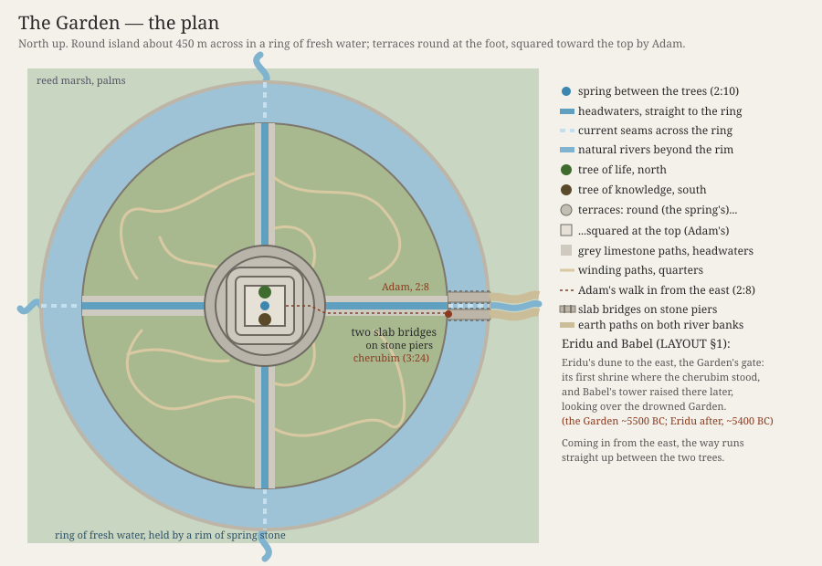

# The Garden — The Look and the Research Behind It

> How the Garden of Eden looks in *Adonai*, topic by topic: each section gives what's decided first, then the reasons and the sources. The one-page summary is the [dossier](./DOSSIER.md#2-the-look); open questions are in the [README](../../../../README.md#what-i-need-from-you). Provenance tags and fit grades as in the [ROADMAP](../../../../ROADMAP.md) (§4, §8.8). How each decision was reached is in git's history and in Discussions [008](../../../../discussions/008-adam-eve-and-the-garden.md) and [009](../../../../discussions/009-god-in-the-garden.md).

**Status:** v2.0, 2026-10-13. The Garden's look as decided, by topic, with the research behind each part.

**The rule for the whole Garden (yours):** "Try to find the line between natural and too rare to be natural; I think that's where the magic is here." Everything below sits on that line: each thing has a natural cause you could find somewhere on earth, and the Garden has all of them at once, more perfectly than anywhere does. That's how the second register (God through the world, [009](../../../../discussions/009-god-in-the-garden.md#decision)) reads in the Garden's own geography: nothing impossible, just too well arranged to be chance.

**Grade for the whole design: Compatible.** Supported on the river dividing (Gen 2:10), the trees at the centre (2:9), the mountain (Ezek 28:14) and the way east (3:24); Compatible on the water all round (Ezek 31:4 is an echo of Eden, not a description of it; §13.1). The shapes are P4 (the sanctuary, the plain's temples, the ancient gardens) staged as P5 (yours).

---

## 1. The place and the date

**Decided.** The lower plain between the rivers, at the sea's edge as it then was: out in the marsh, just west of the dune where Eridu will stand, about **5500 BC**. The Garden comes first; Eridu is built after the expulsion, at its gate. The Garden is **a stranger in the plain** ("unordinary but not impossible"): a limestone island where the plain has only mud. The Nile isn't the Gihon ([008, round 2](../../../../discussions/008-adam-eve-and-the-garden.md#round-2--2026-10-08)).

### 1.1 Why there: where every water meets

**What the text gives.** God chose the place: "the LORD God planted a garden in Eden, in the east" (2:8). Three things in the text make it *this* place:

1. **Water in a land without rain.** "The LORD God had not caused it to rain on the land... and a mist (*'ed*) was going up from the land and was watering the whole face of the ground" (2:5–6). In a rainless land, life is only where water comes up or comes down a river. The Garden is where it does both.
2. **The source of the world's rivers.** "A river went out from Eden to water the garden, and from there it divided and became four heads" (2:10), and the four reach Havilah, Cush, Assyria and beyond (2:11–14). On the decided geography they're the Tigris, the Euphrates, the Karun from Iran and the dry Wadi al-Batin from Arabia, all meeting at the head of the Gulf.
3. **Where God is met.** "They heard the sound of the LORD God walking in the garden" (3:8). It's the first sanctuary (§13.3).

**What the place has that nowhere else does.** The spot is where every kind of water in that world meets: the four rivers from four lands, the sea, and fresh water rising from below (§3). The Sumerians named the two waters, the *Abzu*, the fresh water under the earth, and the salt sea; Eridu stood where they met, and its temple was the house of the Abzu. It's the one place where the waters God separated (1:6–10) come back together for life, at the centre of the world those people knew. The film never says so; the audience should feel it, water arriving from every direction and rising in the middle. *P6.*

**The ancient memory of the spot:**
- **The first city.** "After kingship descended from heaven, kingship was in Eridu" (the Sumerian King List).
- **The place of the undying.** At the end of the flood story in *Gilgamesh*, the flood hero Utnapishtim is given eternal life and settled "far away, at the mouth of the rivers" (Tablet XI).
- **Paradise down the Gulf.** Dilmun, "where the lion kills not," where Enki makes fresh water rise from the ground (*Enki and Ninhursag*; §1.5).

**Why Adam is brought there.** He is made outside the Garden and brought in: "there he put the man whom he had formed" (2:8); "the LORD God took the man and put him in the garden of Eden to work it and keep it" (2:15). The verb in 2:15, *wayyanniḥehu*, from *nuaḥ*, "to rest," means here "set down, place," and it's the verb for things set down before the LORD in the sanctuary (Exod 16:33–34; Num 17:4). *Medium confidence on how much weight that parallel carries; Wenham and Walton both draw it.* Two reasons are stated: to work it and keep it (2:15; "there was no man to work the ground," 2:5), and to be where God is met (2:16–17). His line walked from the Nile across the gap ([008](../../../../discussions/008-adam-eve-and-the-garden.md#round-2--2026-10-08)), so the Garden is not where he was born: he's brought from the wild world to the one place in it where everything comes together.

### 1.2 The date: about 5500 BC, before Eridu

1. **Eridu's first building.** Eridu was founded about 5400 BC, early in the Ubaid period; the dates given for its first levels run 5500–5300 BC. Eighteen temples were built one over another on that spot, ending under Amar-Sin's unfinished ziggurat (about 2047–2039 BC). The excavators dug down to clean sand under the first shrine ("a virgin sand-dune site with no previous habitation"), so the Garden isn't under Eridu: it lies out in the basin, west of the dune, and has to be over by about 5400 BC, give or take a century. *High confidence on the sequence; medium on the founding date, within about a century.*
2. **The genealogies.** On this project's model (Abraham born 1951 BC, [TIMELINE](../../../../world/TIMELINE.md#34-primeval-history-genesis-111)), the Hebrew text puts Adam about 3900 BC and the Greek text about 5270 BC (3,314 years from Adam to Abraham). Neither reaches 5500, which is about 230 years earlier than a strict Greek count. The date works because the project doesn't read the genealogies as a complete calendar (TIMELINE §3.4; FR-01, the people before Adam): many scholars read them as selective, with generations left out (William Henry Green, 1890; Kenneth Kitchen, 2003). The dating of Genesis 1–11 as a whole is README item 4.
3. **The sea and the land.** The Gulf's rising water reached the northern Gulf by about 6000 BC (marine and brackish water near Basra); by about 5000 BC its deposits reached Lake Hammar, 80–100 km inland of today's shore; the estuaries reached furthest inland about 4000 BC. The first Ubaid villages sat on low rises "at the interface between fresh and salt water" (Kennett and Kennett, 2006). At 5500 BC the Garden's country is marsh and channels, fresh water meeting the advancing sea. *Medium-high confidence; calibrated radiocarbon dates, rounded.*
4. **Cain's city.** "Cain... built a city" (4:17); "to Enoch was born Irad" (4:18). Irad as Eridu is Nahum Sarna's suggestion, among others' (*JPS Torah Commentary: Genesis*, 1989; *a serious suggestion, not a consensus*), and some read 4:17 as Enoch building the city and naming it for his son. Either way Genesis puts the first city east of Eden, where Eridu is: Eridu, about 5400 BC, is Cain's city, and Uruk is the later great city of Nimrod's kingdom (Erech, 10:10).

**The shrine at the gate.** Eridu's first shrine, the small square on the dune, rebuilt over the fresh water eighteen times, is where the people outside build, because God was last near there, at the way the cherubim guard (3:24).

**Grade: Compatible.** The date is inside what a reading of the genealogies with gaps allows. P4 for the archaeology; P5 for the reading.

### 1.3 The neighbours

| Place | From the Garden | In the Bible | Why it matters |
|---|---|---|---|
| **Eridu** | at the Garden's gate, just east | not named (Irad, 4:18, on Sarna's reading) | The first city (the King List); temple of the fresh water rising, rebuilt on the same spot 17 or 18 times from about 5400 BC; its last great tower, Amar-Sin's (about 2040 BC), was never finished. |
| **Ur** | about 20 km | Abraham's city: "Ur of the Chaldeans" (11:28, 31) | **The man God calls out (12:1) is born within sight of where the Garden was.** |
| **Uruk** | about 65 km | Erech, in Nimrod's kingdom (10:10) | The world's first true city, about 4000–3100 BC. Its king Enmerkar asks for materials for "the lofty Abzu temple of Enki at Eridu" in the Sumerian story that tells of the speech of mankind being changed. |
| **Babylon** | about 240 km up the Euphrates | "Babel, Erech, Accad and Calneh, in the land of Shinar" (10:10) | Its central quarter, where Marduk's temple Esagila stood beside the great ziggurat Etemenanki, **was called Eridu** (*Tintir*, Tablet V: "Eridu, in which Esagila is built"; A. R. George). |

*Distances measured on the sites' published coordinates, straight line (Ur about 20 km; prose sources give anything from 12 to 24). The Sumerian story is* Enmerkar and the Lord of Aratta*; its "Spell of Nudimmud" (Nudimmud is Enki, Eridu's god) has Enki "change the speech in their mouths." Scholars have compared it to Babel since Samuel Kramer, and they disagree on whether the spell breaks the one language apart or makes it one.*

### 1.4 Babel is Eridu

**Decided.** Babel's tower is raised on Eridu's dune, at the Garden's gate, looking over the drowned Garden. The name *Bab-ili*, "gate of god," is then literal: men build their own gate to heaven where God's gate to the Garden stood.

1. **Babylon called itself Eridu.** A Babylonian hymn in praise of the city, from the library at Sippar, says of it: "It is called Eridu, Babylon is its name," and calls Alulu, the first king of Eridu in the Sumerian King List, "king of Babylon" (Anmar Fadhil and Enrique Jiménez, *Iraq* 86, 2024). The city text *Tintir* names Babylon's central quarter "Eridu" (Tablet V; A. R. George, *Babylonian Topographical Texts*, 1992). And the Babylonian creation by Marduk has Eridu and Esagila made first, "in the midst of the Apsû," and Babylon after (the bilingual creation account, *CT* 13 35–38). Babylon claimed Eridu's place as the first city; on this reading Genesis's Babel is the place that claim was taken from. *High confidence on the texts.*
2. **Eridu's tower is the old one.** Its platform was raised over the fresh water eighteen times from about 5400 BC, the oldest sacred building in the land, and its last tower, Amar-Sin's, was left unfinished ("they left off building the city," 11:8). Babylon is first mentioned around 2200 BC, as a small town, on a tablet from the reign of Shar-kali-sharri of Akkad.
3. **The changed speech is told about Eridu** (*Enmerkar*, §1.3).
4. **The ground.** "Brick for stone, and bitumen for mortar" (11:3) is how Eridu was built: mudbrick on a plain with almost no stone.
5. **The same aim.** "A tower with its top in the heavens" (11:4) is the mountain of God (Ezek 28:14) rebuilt by hand, its brick against the Garden's stone (§4). "Let us make a name for ourselves" (11:4); and to the man from Ur, about 20 km away: "I will make your name great" (12:2).

**The date.** The Amar-Sin echo needs Babel about 2040 BC, under the kings of Ur, still before Abraham (1951 BC). If Babel is dated earlier, about 2400–2200 BC (README item 4), the tower they leave unfinished is an earlier platform at Eridu, and Amar-Sin's is its last echo. Either works.

**The case against.** Genesis lists Babel with Erech, Accad and Calneh in Nimrod's kingdom (10:10) and puns its name on *balal*, "confuse" (11:9), and every later book means Babylon by Babel. That's **Tension**, not contradiction: Genesis gives no coordinates, and Babylon itself took Eridu's name. The series can show both: the tower at Eridu, and the name carried north later with the claim. David Rohl (*Legend*, 1998) argues the two cities were confused because both were written NUN.KI; Eridu's name is NUN.KI, but no source I found shows Babylon written that way, so it isn't part of the case. Babel built over the Garden's centre was the other option and is set aside. How drowned the Garden is when the tower goes up depends on the flood (README item 3). *P4 for the texts; P5 for the reading. Grade: Tension on Babel's location (10:10), Compatible on everything else.*

### 1.5 Dilmun: the same memory, a different place

Dilmun is Bahrain and the coast beside it, about 500 km down the Gulf. But the traditions run together: in the Sumerian flood story the survivor, Ziusudra, is given life like a god and settled "in the land of Dilmun, where the sun rises"; in *Gilgamesh* XI the same man is settled "at the mouth of the rivers." Both sit on the Gulf where fresh water comes up through the salt. Juris Zarins's argument (008) adds a reason: the Gulf's floor was dry land at the end of the last ice age, and the rising sea reached its head only between about 6000 and 4000 BC, so a remembered paradise could drift south along a coast that kept moving. The Garden stays at the head of the Gulf where Genesis's four rivers meet; Dilmun can be **how the world outside remembers it later**, a name for what's lost. *P4 for the traditions (high confidence); P5 for the reading.*

---

## 2. The island and the ring

**Decided.**
- **The island:** round, about 450 m across, raised a metre or two above the water. Its edges are stone and roots. Walking from the shore to the centre takes about three minutes.
- **The ring:** fresh, slow, clear water, 30–60 m wide, all the way round: the spring's own pool, held a little above the marsh by a low natural rim of spring stone (§3). Reeds and date palms on the outer bank, the plain's own, seen from inside.
- **Beyond it:** the reed marsh, then the plain and, on the far south-east horizon, the sea.
- **No wall.** The Garden's edge is where the water stops, so the outside can be seen from inside as a frontier (008's "wild, not hostile").

**Why water all round.** It makes *gan*, the enclosed garden (§13.1), an enclosure without a wall, which keeps the text (no wall, only a way in from the east that can be guarded) and gives the *gan* its edge. Eridu itself was a rise ringed by water (§13.2). It turns 3:24 into something you can see: water on every side and one way across it, from the east. And the lower plain about 5500 BC was a land of marsh and channels at the sea's edge, so an island is the most natural thing in it. Ezekiel's great cedar, the tree Eden's trees envied, has "its rivers flowing *around* the place of its planting" (31:4): an echo of Eden, not a description of it, but the picture is there.

**Why a ring and not a square.** A spring mound is round in plan, and the water spreading from it makes rings; travertine terraces form curved, lobed steps, not straight ones. On your rule, a square island is on the wrong side of the line; the ring is on the right side. Ezekiel's *sevivot*, from the root "to turn, go round," suggests the ring without proving it.

**Fresh inside, salt far off.** The water round the island is fresh and moving, the headwaters running out into it and through it, so it's the river leaving the Garden, not a moat holding it in. The salt sea is only on the horizon. That's the line the Sumerians drew at Eridu (Enki's fresh Abzu against the salt sea), and it answers Revelation's "no more sea" (21:1): the fresh water is the Garden's, the sea the world's.

**The case against.** Genesis 2:10 has water flowing *out* of the Garden in four, not round it; the ring answers it by being the spring's own pool, always moving outward (§3). **Grade: Compatible.** P5.

---

## 3. The water: the spring, the headwaters and the rivers

**Decided.**
- **The spring** is artesian. It rises from a fissure on the open top, between the two trees, and it built the terraces itself (§4).
- **Four headwaters,** the spring's four overflows, run down the four faces of the terraces and straight across the island to the four directions: the "four heads" of 2:10. They follow the limestone's joints, and Adam's work makes them straighter still.
- **At the ring,** each pours in, and its current carries straight across the still water as a **current seam**: a line of clearer, smoother, slightly cooler water with petals and leaves drifting along it. Any stream entering a pond does this; here it's unusually clean.
- **On the far side,** each leaves through the low rim of spring stone. Travertine builds rim-dams around its own pools, which is how terraced pools hold their water. From there **it wanders as a natural river** into the marsh, toward its own land.
- **The water always moves outward.** The ring is held up by its rim a little above the marsh, so fresh water rises in the middle and leaves in four directions.
- **The morning mist** lifts off the moving water: the *'ed* of 2:6, made visible.

**What the texts assume.** The Bible's water comes from below as well as above: "a mist (*'ed*) was going up from the land" (Gen 2:6); "the deep (*tehom*) made it grow tall" (Ezek 31:4); "the fountains of the great deep burst open" (Gen 7:11); water "from below the threshold" of Ezekiel's temple (47:1); "springs, flowing out in the valleys and hills" (Deut 8:7). The people of Eridu believed the same about that spot: Enki's temple was the *Abzu*, the fresh water under the earth, rising.

**What the geology says.** The plain's western edge sits on a great limestone aquifer, the Dammam: layers of fractured limestone running under Arabia and the Gulf. Rain that fell on Arabia's higher ground soaks into the limestone and flows north-east underground for hundreds of kilometres. Because it enters high and is sealed in under other rock, it's under pressure, and wherever a fault or fissure gives it a way up, it rises on its own: an *artesian spring*. Real ones in the region:

- **Bahrain, ancient Dilmun,** the Sumerian paradise: famous for freshwater springs fed by this aquifer from Saudi Arabia, through "highly fractured limestones," until 20th-century pumping stopped them. Divers' accounts also tell of fresh water welling up from the seabed (*medium confidence*).
- **Sawa Lake,** about 25 km southwest of Samawah, a little over 100 km up the Euphrates from Eridu: a lake in the desert with no river in or out, fed by groundwater from the higher desert to the west.
- **The springs along the Euphrates' desert edge,** such as Ain al-Tamr west of Karbala (*medium confidence on the details*).
- **Around 5500 BC the region was wetter** than now (the mid-Holocene humid phase), so the aquifers were fuller and the springs stronger. *Medium-high confidence.*

**Out in the marsh: rare, not impossible.** Under the delta the same water-bearing limestone is still there, buried under the rivers' mud. The water under pressure needs a crack to come up through, and cracks exist: the ground under southern Iraq is folded and faulted (the buried domes of the oil fields near Basra are such folds), and Bahrain's springs were said to rise even through the seabed. A spring that finds a fault keeps flowing, and its lime builds a mound until it stands above the marsh. Nothing like it is known there today, but the mud has been piling up on that plain for seven thousand years and could bury one. At the desert's edge it would be ordinary; in the marsh it's rare, which is what the Garden is. *Medium confidence on the faults; high that the limestone runs under the delta.*

**Why the headwaters run straight.** Limestone cracks along straight parallel joints, and water running over it follows them, so a spring's channels across bare limestone really do run in near-straight lines. Straight enough to feel laid out, not so straight it couldn't have happened.

**Grade: Compatible,** the region's springs at P4 (real), the spring in the marsh and the shape of the water at P5.

---

## 4. The stone and the terraces

**Decided.**
- **The ground is grey limestone,** not masonry. Along the headwaters it lies bare as a natural *limestone pavement*: broad, flat slabs, the paths on both banks of each channel, smooth, clean and wide. Elsewhere it's under soil and planting.
- **The centre is five broad, low terraces of old grey spring stone,** built by the spring itself: round at the foot as the spring laid them, and squared toward the top by Adam's work.
  - **Size:** about 130 m across at the foot, a 40 m square at the top, each step about two and a half metres high, about 12 m in all.
  - **Surface:** worn, overgrown at the edges, smoothed where he worked them.
  - **The way up:** a ramp or stair in the middle of each face, beside the channel.
- **The top is open:** a pavement of lighter stone that catches the sun, Ezekiel's "stones of fire." Pale, glistening lines run where the fresh water flows down the grey steps.
- **The stone itself:** weathered, dry-laid (no mortar), worn smooth where feet go, green with moss where water runs. It's darker grey at the waterline and in the channels, lighter at the summit. Never cut, never carved: placed.

**Why a stepped centre.**
1. **Eden is a mountain in the Bible's own memory.** "You were in Eden, the garden of God... you were on the holy mountain of God; in the midst of the stones of fire you walked" (Ezek 28:13–14). A river flows *out* of Eden to water the garden (2:10), which is what water does from high ground.
2. **It's what the people of that plain built.** Eridu's temple began as a shrine on a platform; each rebuilding raised the platform, and that sequence is where the ziggurat comes from. A stepped centre says the Garden is the first sanctuary in the plain's own language, before anyone has built one.
3. **It gives Babel its meaning.** "A tower with its top in the heavens" (11:4) is humanity rebuilding the Garden's centre without the trees, to make a name instead of to meet God. "They had brick for stone" (11:3): the Garden's stone is the sign that it isn't the plain's own work, and the tower's brick is the sign that it is.
4. **It stages the hour.** The command is given at the top, in front of the trees; the temptation is a climb; the Fall happens on the open top with the whole Garden below; the sound in the evening wind (3:8) reaches two people hiding on it; and the way east is a descent.

**How a spring builds its own hill, in steps.** Spring water that has passed through limestone carries dissolved lime. Where it comes out and runs over the ground, it lays the lime down again as new stone, and over centuries a spring can build a mound under itself and rise on it. Where the water spills over edges, it builds **terraces, step after step, with the water running down each one.** Pamukkale in Turkey and Badab-e Surt in northern Iran are the famous examples. So the water answers where the river comes from, why there are steps, and who built them: nobody cut anything, and "the LORD God planted" stands. *The catch:* the big terraces at Pamukkale come from warm, mineral-rich water, and I can't show that the Dammam's water built anything like them; the mechanism is real, the scale is our choice. *On names:* warm springs build travertine, cool ones build tufa, a softer, more porous stone of the same kind. A cool aquifer spring would build tufa. "Travertine" is the look word here for the old, weathered grey stone; fresh, it's tufa, soft enough to shape by hand.

**Why the ground can be limestone.** Bare limestone bedrock naturally weathers into a *limestone pavement*: broad flat slabs (*clints*), often several metres across (3–4.5 m is well within it), split by straight fissures (*grikes*) where water has widened the rock's joints. The fissures run in parallel sets, like grooves cut lengthwise every so often, and ferns, mosses and small flowers grow in them; shallow basins dissolve into the surface and hold rainwater. The Burren in Ireland and Malham in Yorkshire are the famous ones. This solves three things:
1. **Nobody has to have built it.** "The LORD God planted" (2:8).
2. **The texts prefer uncut stone where God is met.** "If you make me an altar of stone, you shall not build it of hewn stones, for if you wield your tool on it you profane it" (Exod 20:25; Deut 27:5–6); "neither hammer nor axe nor any tool of iron was heard in the house" (1 Kgs 6:7).
3. **The color rule gets a home in the stone.** The grey slabs are lifeless, and the color grows in the cracks between them (§7.2).

**A stranger in the plain.** The lower plain is river silt, many metres deep, with no rock at the surface: that's why the plain built in mud brick (11:3). There is stone at its western edge: Eridu sits beside a low sandstone ridge, and the desert plateau west of the Euphrates is limestone and sandstone. *Medium confidence on the exact formations; high that the alluvium has no surface rock.* So a limestone rise out in the marsh is deliberately unnatural for the place, the spring that built it is the reason it's there (§3), and when the Garden is gone the plain has only mud, which is the point of Babel's brick. Placing it at the plain's edge, on the plateau's limestone, would be ordinary geology and lose the strangeness; it's set aside.

**Adam's square.** Round is God's planting; square is the man's work. "To work it and keep it" (2:15): his first work shapes the ground he was given.
- **It explains every square after it:** Eridu's temple platforms, the ziggurats, Babel's tower, the square holy of holies, Revelation's square city all remember the shape the first man gave the centre. Babel copies his square without the trees.
- **Revelation fits it:** the Garden at the beginning is round; the city at the end is square, and "the kings of the earth will bring their glory into it" (Rev 21:16, 24), God's planting and human work joined. *P6, and never said in the film.*
- **It needs no cutting.** Fresh tufa is soft when wet and hardens in the air; it can be scraped, pressed and squared with wood and stone tools, by hand. That's shaping, not hewing, so it keeps to the spirit of Exod 20:25. *Medium-high confidence on tufa's softness.*
- **It plays.** Through their life (movement 4) we see him work it: clearing, edging, squaring the top around the two trees. By the Fall the top has edges.
- **The case against:** the text says nothing of building, so Adam as the first architect is P5; and a partly man-made holy centre is Babel's impulse turned the right way, a strength if the series wants the rhyme, a risk if it reads as Adam improving on God. So his work stays modest: edges and a level top, not monuments.

**Why not masonry.** It isn't impossible for the period: at Göbekli Tepe, about 9500 BC, people quarried and shaped limestone pillars over five metres tall. But smooth, precise slabs would say "someone built this," and the question becomes who. The rock's size and flatness carry the awe instead.

**Grade:** natural pavement, **Compatible**, close to Supported by Exod 20:25; the limestone island in the marsh P5 and deliberately unnatural; the spring-built terraces P5; precise masonry would be **Tension** with "planted" and Exod 20:25.

---

## 5. The paths and the quarters

**Decided.**
- **The headwater paths** are the grey limestone pavement on both banks of each channel (§4), straight from the terraces to the ring.
- **The four quarters,** between the headwaters, are planted quarters of the circle, each different: one of orchard, one of tall trees, one of flowering plants and open ground, one dense and shaded.
- **Clear paths wind all through the quarters,** and they aren't limestone: packed earth, fine pale gravel, sand, stepping stones across the wet places, the soft ground worn smooth by feet and hooves. They curve with the land and the trees, the way animal trails do.
- **They're clear and tended,** the planting kept up to their edges. The animals use both kinds of path.

The smoothness has natural causes too: limestone and spring stone wear smooth under water and feet, and the animals use the paths every day. How kept it all is, and by whom, is §8.

---

## 6. The trees, the plants and the animals

### 6.1 The two trees: life north, knowledge south

**Decided.** The two trees stand on the open top on either side of the spring: **the tree of life to the north, the tree of knowledge to the south.** They look different from one another, but neither looks strange (3:6). From the top you can see the whole Garden and the water round it.

**Why north and south.** The east–west line runs between them. Anyone coming in by the only way, from the east, walks straight up the eastern headwater and the terraces with the two trees standing on either side of the way and the spring between them. That's the shape of every sanctuary Israel later built: an entrance facing east, two things flanking the way in (the two cherubim over the ark; the bronze pillars Jachin and Boaz on either side of the temple porch, 1 Kgs 7:21). It's Revelation's tree "on either side of the river" (22:2). Leaving is the same line run backwards.

**Why knowledge to the south** (my pick, P6). At that latitude the sun always stands in the south, so from the spring the southern tree is always seen against the sun: backlit, its edges and fruit glowing, its face in shadow. That's 3:6 in light: "a delight to the eyes." The northern tree is always seen in full light, plain and steady. And the north is where the Bible puts the mountain of God (Ps 48:2, "Mount Zion, in the far north"). The case against: Isaiah 14:13 puts the would-be usurper's climb "in the far reaches of the north." The light argument is the stronger one.

### 6.2 The plants and animals

**Decided (your rule):** "the plant and animals should be of the region, or at least the plants and animals of the extended surrounding region." The region is the lower plain and its marshes; the wider region is the arc around it that its people knew: the Zagros and Taurus mountains, the Levant, the Arabian edge. Everything below is native there, as far as I can check. *Medium confidence on some ranges as they stood about 5500 BC.*

**This loses almost nothing from the texts.** The trees the Bible names in Eden are all of the wider region: the fig (3:7), and Ezekiel's cedar, *berosh* (cypress or juniper) and plane (31:8), which grow in the Levant, the Taurus and the Zagros. The Sumerian kings went to the same mountains for cedar (Gilgamesh's Cedar Forest). The Garden reads as **the whole region in one place**, the hill trees, the marsh plants and the animals of the steppe together, where in the world they're days apart. That's the sign that someone made it.

**Trees.** Inside, from the hills and the Levant: plane (pale bark, over the channels), cedar and cypress (the tall quarter), oak (the Zagros oak), terebinth and wild pistachio, almond (the lampstand, Exod 25:33), pomegranate (1 Kgs 7:18), fig (3:7), olive (the dove's leaf, Gen 8:11), wild grape climbing them, and a few *Commiphora* on the dry upper terraces (the bdellium, §7.3). At the water and the shore, the plain's own: date palm (the temple's palms, 1 Kgs 6:29), tamarisk, Euphrates poplar and willow (the "willows" of Babylon, Ps 137:2, are probably this poplar), reeds. Outside, after 3:18: Christ's-thorn jujube and camelthorn, the thorns and thistles.

**Undergrowth and flowers,** where the color lives: oleander along the channels, myrtle, wild rose, caper on the stone, ferns and moss in the limestone's fissures; wild tulips, irises, poppies, anemones, cyclamen, crown imperial lilies, crocus; water lilies in the still water. Wild wheat and barley at the edges, which matter later: "by the sweat of your face you shall eat bread" (3:19). The blue and yellow ones are in §7.2.

**Animals.** The plain's: lion, aurochs, onager and the marsh birds (pelican, flamingo, ibis, heron, kingfisher) from [008's check](../../../../discussions/008-adam-eve-and-the-garden.md#the-check-the-ur-and-uruk-country), with gazelle, wild boar and the Mesopotamian fallow deer. The wider region's: leopard, cheetah, striped hyena, wolf, brown bear (the Zagros and Lebanon), wild goat and ibex, mouflon, ostrich, otter in the marsh, softshell turtle, the hoopoe. Fish in the channels: the rivers' barbels. The serpent is one of the region's own snakes; choosing which is for the treatment. Not in: peacocks, parrots, anything that says "paradise" from somewhere else. Two are of the wider region and so allowed by your rule, but left out by choice because on screen they read as India: the Syrian elephant, which lived on the middle Euphrates and the Orontes into historical times (Thutmose III hunted them at Niy, about 1450 BC), and the Caspian tiger in the Zagros and the Taurus (*medium confidence on the tiger's range*).

---

## 7. Light, color and gold

### 7.1 The light

**Decided.** "Sunny yet cool and breezy, not hot and humid." Dry, clear air, crisp shadows, a breeze off the water, and **the shade makes the blue.** The Garden always looks like the plain's spring (March and April: mild, green, clear).

**Why it looks this way.**
- **Dry, clear air** is what makes the Greek-feeling light you mean: hard bright sun, deep blue sky, crisp shadows, a breeze. Humid heat is the opposite: haze, soft shadows, a white sky.
- **Cool in a hot country,** naturally: shade over most of the ground; moving water everywhere (spring water rises at the ground's own temperature, cool against the air); and wind off the water and the Gulf. The text gives the wind: "the wind of the day" (3:8).
- **The blue comes from the shade, not the sun.** Direct sunlight through leaves is warm, and the light under a canopy is green. Shadows lit by open sky are blue, and fine mist scatters blue light. So the look is **cool blue shade, a brief morning mist, and warm shafts of sun cutting through.** The blue is in the light, never painted on the stone.
- **Blue in the texts:** the pavement "like sapphire, like the very heaven for clearness" (Exod 24:10), the throne "like sapphire" (Ezek 1:26), Eden's *sappir* (Ezek 28:13, almost certainly lapis lazuli), and Gilgamesh's lapis leaves.

*P5; the climate facts are high confidence.*

**The times of day:**
- **Morning:** a brief mist off the water and the channels that burns off in the first hour, so it's a dawn image only, never a haze. Cool blue shade, warm shafts through the trees.
- **Day:** the blue thins out but stays in the shadows. Grey stone, deep green, and color only in what lives.
- **Evening (3:8):** the wind of the day moving the trees; the light goes long and gold across the terraces; the shadows go deep blue.
- **Outside:** the plain's summer: flat, white, hot, hazy, without shade, heat shimmer and dust.

**Shadow is the main tool** (your note: "a natural, peaceful, and beautiful mood... correct use of shadows for these scenes will be what makes them").
- **Most of the frame is in shade.** The sun lands in a few patches and shafts, and the eye goes to them. The Garden is lit the way a forest floor is lit.
- **The shade is cool and full, never black.** Sky light fills the shadows with blue, and light bouncing off the pale stone and the water lifts them. Peaceful means you can see into every shadow.
- **The canopy moves.** Leaf shadows drift on the stone in the wind, slowly; in the evening (3:8) the wind gets stronger and the shadows move with it.
- **The grikes hold the deepest dark,** with green and color growing out of them.
- **Low sun, long shadows.** Morning and evening carry the Garden. Noon is flat and kept for outside.
- **After the Fall, the shadows change meaning, not look.** They hide among the trees (3:8): the same shade that was rest becomes cover.

### 7.2 Color: grey and green, with blue and yellow

**Decided.**
- **Stone and neutral** for everything that doesn't live, **forest green** for everything that grows, and color **only in what lives** (plus light, water and sky): flowers, fruit, birds, fish in the channels, the animals' coats. Nothing made is colored.
- **Blue and yellow are the accent,** complementary, drawn out wherever they come naturally, small and scattered against the grey and green. Nothing made is blue or yellow.
- **The serpent** is the one living thing whose color is wrong.
- **Outside, after 3:24,** the first shot has no color at all: mud, dust, thorns, heat.

**Why.** The Opening's colors came down from the particle sea to real birds over a real delta; the rule gives them one home in the Garden, which is life.

**Blue:**
- **Sky and water:** the deep sky of dry, clear air, the shade, the channels, the ring, the dawn mist.
- **Flowers:** irises and grape hyacinth from the Zagros and Taurus spring, chicory, alkanet, blue flax, cornflower.
- **Birds:** the white-throated and common kingfishers; the European roller, turquoise, passing through in spring; the blue rock thrush, a blue bird on grey stone.
- **Insects:** blue damselflies and dragonflies over the channels.

**Yellow:**
- **Light:** the sun's shafts through the canopy and the gold evening (§7.3).
- **Flowers:** crown daisy, yellow flag iris at the water's edge, wild mustard, buttercups, the centres of chamomile, and wild barley turning gold.
- **Birds:** the golden oriole.
- **Living things:** bees and pollen in the light, the bdellium resin (§7.3).
- **On the stone:** yellow lichen on the old grey limestone, which is alive, so inside the rule.

**Where they meet:**
- The **European bee-eater** carries both, a yellow throat and a blue-green belly, in flocks over the water.
- Yellow flag iris stands against blue water.
- Yellow lichen and a blue rock thrush on the same grey step.
- A shaft of yellow sun falls into a blue shadow.

**Grade: Compatible.** The species are of the region or the wider region, at P2/P4. *Medium confidence on the exact ranges of a few flowers about 5500 BC.*

### 7.3 Gold

**Decided:** gold as long as it's factual. That means three things:
1. **Gold light.** The evening of 3:8 is the gold hour: the sun low, the light long and gold across the grey stone.
2. **Bdellium,** the text's own word, in the verse with the gold (2:12). It's the resin of *Commiphora* trees, the myrrh family of southern Arabia and the Horn of Africa; one species, *C. gileadensis*, grows wild in western Arabia. It beads on the bark, translucent and golden, and backlit by the low sun it glows like amber. Manna looked like it (Num 11:7). A few trees grow on the dry upper terraces, since it's a tree of dry ground. *High confidence that the classical bdellium is Commiphora resin; medium that the Hebrew* bedolah *is the same thing (some ancient readers took it for pearl).*
3. **Living gold.** Wild barley and wheat ripening at the edges (both grow wild in the Zagros foothills), golden orioles (they pass through Iraq on migration), bees and pollen in the shafts of light, the lion's coat.

**No gold in the water.** In the plan, water only flows *out* of the Garden (2:10), so nothing from Havilah comes in. And gold you can see doesn't travel that far: visible grains of placer gold settle out within tens of kilometres of the rock that released them, and Arabia's gold country (Mahd adh-Dhahab, "the cradle of gold," mined since antiquity) is about 950 km from Eridu. The text keeps the gold where it says it is, in Havilah (2:11–12). *High confidence.*

**Nothing gilded:** gold on anything made would read as a temple and break the color rule. Ezekiel's "crafted in gold" (28:13) belongs to the figure in the parable, not to the ground. **Grade: Compatible.**

### 7.4 The Greek feel, without Greek forms

What you're after is a mood: old stone in a grove, raking light, a place that is a sanctuary without being a building. That's honest to the text, which makes the Garden a sanctuary and gives it plane trees and cypress (Ezek 31:8). The feel comes from:
- the dry, clear light (§7.1);
- the plane trees with their pale bark over the water, cypress, cedar, olive, fig and pomegranate;
- the grey limestone terraces, like the old dry-stone terraces of Greek hillsides.

The forms (columns, capitals, pediments, marble, statues) belong to the first millennium BC and to Greece, so they're three thousand years too late for the plain. They would also turn the Garden into the Hesperides (§13.2). **Grade: Compatible** for the feel; **Contradiction**, of the setting rather than the text, for any Greek architecture.

---

## 8. One man's work

**Decided.** The Garden looks "artificial enough to look like Adam has been there for years, but natural enough to still seem like only one person worked to upkeep" it. The audience almost thinks it isn't natural, and then, thinking about it, sees how one man could have done it with time. It's your rule seen from the other side: too kept to be wild, never more than one pair of hands could keep. **It already looks so when Adam first walks in** ("Prepared"): God's planting, made ready for him, as if someone has kept it, and no one is in sight. His own work, through movement 4, keeps it so and adds his marks (the squared top, the straighter headwaters, §4).

**Who planted it is open.** On the pick in [README item 15(c)](../../../../README.md#the-garden), Adam's ancestor planted it, God speaking through him ([009](../../../../discussions/009-god-in-the-garden.md#decision)), which makes "only one person" literally true.

**What one man can do, so it shows:**
- path edges a little too clean;
- stone swept;
- stepping stones set exactly a stride apart;
- plants pruned and trained, slightly too even;
- no dead wood, no clutter, no overgrowth across a path;
- channels cleared;
- loose stones set along the edges;
- the top squared and levelled, by scraping and pressing fresh spring stone (§4).

**What he can't do, so it never shows:**
- carving;
- walls;
- moved monoliths;
- regular masonry;
- symmetry beyond the cross of the four headwaters.

Plants of different ages, a few things left to grow as they will, and wear where feet go keep it on the line. The softening is in the shapes, not in the care: edges irregular, nothing ruler-straight, but never wild. The wildness is outside.

---

## 9. The way east: two slab bridges

**Decided.** Two bridges of limestone slabs on stacked-stone piers, one on each side of the eastern river where it crosses the ring. They carry the eastern headwater's two bank paths across the water, and the ring flows on under them. Outside the rim, **earth paths keep to both banks of the river** for a while as it winds into the marsh, before they part from it. It's the only dry way in or out, and the cherubim and the turning fire stand at the crossing (3:24). The details below are my picks (P6), checked, and yours to change.

**Why they need piers.** No slab can leap the ring in one: the ring is 30–60 m wide. Limestone is strong when pressed and weak when bent, so a slab works as a beam only over a few metres; long before 30 m it breaks under its own weight. So the bridges are *clapper bridges*: flat slabs laid end to end on piers of stacked stone that stand in the water, the simplest stone bridge there is.
- **Tarr Steps,** on the River Barle in Exmoor: 55 m long, 17 spans, unmortared slabs of up to 2 tons, the largest about 2.4 m long and 1.5 m wide, about a metre above normal water. That's almost exactly the ring's width. (Its date is argued, Bronze Age or medieval; most clapper bridges are medieval.)
- **Postbridge,** on Dartmoor: slabs over 4 m long and over 8 tonnes, first recorded in 1380.

**The build:**
- **The slabs:** each about 2 m long, under a metre wide and 15–20 cm thick, so under a ton each.
- **The piers:** about twenty low piers across a 50 m crossing.
- **The height:** the deck a metre or so above the water, like Tarr Steps.
- **Strength:** my own beam check gives a slab that size a man's weight with a margin of four or more, even for weak limestone.

**The ring stays open.** The water runs between the piers and under the slabs, so the ring is whole all the way round, and nothing dams it; the only things in the water are the piers. The eastern river's current seam runs out between the two bridges. Floods are what wreck clapper bridges (Tarr Steps' slabs have been carried 46 m downstream); the ring is a slow spring pool held by its rim (§3), not a mountain river, so its piers aren't fighting floods.

**No carving, and one man can do it.**
- **Lifted, not cut.** Limestone lies in beds and splits along them into flat slabs, like the pavement the paths are made of (§4).
- **Moved by one man.** A slab under a ton moves with a lever, a pivot stone and wooden rollers. Wally Wallington, working alone with a beam and two pivots, has moved concrete blocks of several thousand pounds and walked a 20-ton barn (his own claims, filmed).
- **Stacked by hand.** The piers are loose stones set one on another: nothing hewn, no mortar, and the slabs aren't the moved monoliths §8 rules out.
- **There from the start.** They're in place when Adam first walks in, like the rest of the Garden, and they look like a man's work (§8).

**The paths outside on both banks.**
- **It's the same line, unbroken:** each bridge carries on one of the eastern headwater's two bank paths.
- **It's the natural ground:** a river in a marsh builds natural levees, the highest and driest ground there is, so a path along a bank is where feet would go.
- **It looks different from the island:** out there the paths are trodden earth, not limestone. The plain has no limestone, so the grey stops at the rim and the eye knows it has left.

**A natural arch, set aside.** A spring can build a stone bridge itself: Tonto Natural Bridge in Arizona is travertine, arching 56 m high over a tunnel 46 m across at its widest, and is believed to be the largest of its kind (the claim is unsourced). It would leave the ring completely clear, but two natural arches, one each side of one river, cross your line into too rare to be natural.

**The way is still one way.** 3:24 guards "the way to the tree of life": one way east, crossed by two bridges a few metres apart. The text gives an entrance on the east and only one "way," and every later sanctuary of Israel faces east too (Exod 27:13; Ezek 43:1–4; 47:1). **Grade: Compatible.**

---

## 10. The walk in

**Decided** (your direction for movement 1; [dossier §3](./DOSSIER.md#3-the-six-movements)).

**The entrance.**
- **Adam's first shot** (2:8, the breath from the cliff let out) is at the **east entrance**, where the bridges reach the island. He stands on the eastern headwater's limestone path, facing west, with the channel running beside him toward the spring and the terraces ahead.
- **It's the one way in and the one way out** (3:24), so the hour's last shots can retrace this walk backwards: down the eastern face, along the eastern headwater, over a bridge beside the river, past the cherubim.

**The walk.**
- **No talking.** He walks from the entrance along the eastern headwater to the centre, then up the terraces to the two trees. The walk can wander off the straight path into the quarters and back (about three minutes straight; the scene can take longer).
- **The animals.** He sees all of them as he walks, the plain's and the wider region's (§6.2): grazing, drinking at the channels, lying in the shade, birds on the stone. They look up at him and go back to what they were doing; the lion lies down. He passes them; he doesn't meet them. Meeting each one comes in the naming (2:19–20, movement 2).
- **Adam:** a man in his early twenties, with a slight, pleasant wonder on his face as he walks and looks.
- **The walk itself is his alone.** It ends at the centre: the climb, the two trees, the world going quiet, the held note, and the command, the first words of the series. Whose voice speaks them is [README item 15(a)](../../../../README.md#the-garden); the pick is Adam's ancestor, aloud, waiting at the trees, God speaking through him ([009](../../../../discussions/009-god-in-the-garden.md#decision)).

**The sound.** Peaceful and natural: no music, or very little. The Opening's held note fades under the wind at the cliff and stays away until the command, so the walk is the first time in the series the world is heard on its own. It's made separately, in FL Studio, like the Opening's sound. What's in it, all of the region:
- **Water:** the spring, the channels, the current seams; a fish turning.
- **Wind** in the plane leaves and the reeds; bees in the flowers.
- **Birds:** the hoopoe's soft "oop-oop-oop"; doves purring; the white-eared bulbul, the commonest garden songbird of Iraq; reed warblers at the edge of the ring; a kingfisher's whistle over the water; bee-eaters trilling overhead; the golden oriole's fluting call.
- **Frogs** at the water's edge.
- **The animals' small sounds:** hooves on stone, an animal drinking.

*High confidence that all of these birds live in or pass through southern Iraq.*

---

## 11. The case against

- **Too designed.** The more geometric it is, the more it reads as human work, against "planted," and as a palace garden. Answer: the shapes are natural (the ring, the spring's terraces, the joints' straight lines), the care is one man's (§8), and the square is only at the top, Adam's.
- **Too much meaning.** Every element has a verse behind it, but the audience shouldn't feel a diagram. The Garden must work first as a place someone would want to be.
- **Anachronism.** The Persian garden, Ezekiel, Revelation and the Greek resonance all come thousands of years after the setting. Under this project's reading the Garden is the original and the later sanctuaries and gardens are its copies (Heb 8:5: the tabernacle is "a copy and shadow"). That's a framing, P5, and the design has to look like a garden first.
- **Restraint.** Some scholars (James Barr among the older ones) caution that Genesis 2–3 is spare on purpose and that reading the temple into it imports a later theology (§13.3). It argues for restraint in the build: nothing that announces itself as a temple.
- **The shape's double.** Herodotus's Babylon is a square with a moat and a river through it (§13.2). Babel and Babylon are humanity's rebuilding of the Garden: brick for stone, a wall for the water, a tower for the trees. The Garden's design has to be clearly natural and alive, so the rhyme reads as Babylon copying Eden and not the other way round.

---

## 12. For the build

All of it is buildable in Blender: a terrain mesh, scattered vegetation (geometry nodes or a scatter add-on), a sun lamp at a low angle with a soft disc for the shafts, a sky texture for the blue fill, volumetric mist, a leaf-shadow layer above the frame, and the bounce left on. In live action it's a terraced water garden, a set or a location in the Mediterranean or Iran with digital extension.

---

## 13. Sources: the texts, the ancient world, the scholars

### 13.1 What the texts say

**Genesis 2–3**

| Feature | Text | What it gives the build |
|---|---|---|
| A garden *in* Eden, in the east | "The LORD God planted a garden in Eden, in the east" (2:8) | Eden is the larger region; the garden is a place within it. *Planted*, not built. |
| *Gan*, a garden | 2:8 and throughout | From the root *g-n-n*, "to enclose, to shield." A *gan* is a protected plot: "a garden locked... a spring sealed" (Song 4:12). The word implies an edge, though the text never says what it is. |
| Every tree, for sight and for food | "every tree that is pleasant to the sight and good for food" (2:9) | Beauty first, then food. |
| Two trees at the centre | "the tree of life in the midst of the garden, and the tree of the knowledge of good and evil" (2:9); "the tree that is in the midst of the garden" (3:3) | A centre. |
| One river, then four | "A river went out from Eden to water the garden, and from there it divided and became four heads" (2:10) | The water rises in Eden, waters the garden, and leaves it in four. "Heads" (*ra'shim*) can mean branches or mouths. |
| Gold, bdellium, onyx | "the gold of that land is good; bdellium and onyx stone are there" (2:11–12) | The same onyx (*shoham*) that's set on the high priest's shoulders (Exod 28:9). |
| Work and keep | "to work it and keep it" (2:15) | The pair of verbs (*'avad*, *shamar*) used of the Levites' service in the tabernacle (Num 3:7–8; 8:26). |
| Fig trees | "they sewed fig leaves together" (3:7) | The one tree named besides the two, near enough to reach in a moment of shame. |
| Trees to hide among | "hid themselves... among the trees of the garden" (3:8) | Dense enough to hide in. Not a park. |
| The wind of the day | "walking in the garden in the wind of the day" (3:8) | The evening breeze: the Garden has a time of day, and a sound. |
| The way east, guarded | "at the east of the garden he placed the cherubim and a flaming sword that turned every way, to guard the way to the tree of life" (3:24) | An entrance on the east, and only one "way." |

**Ezekiel 28 and 31: Eden remembered,** twice, as parables about kings.
- **A mountain** (28:13–16): "You were in Eden, the garden of God... you were on the holy mountain of God; in the midst of the stones of fire you walked." The Garden is on a height, and its top shines.
- **Stones** (28:13): "every precious stone was your covering: sardius, topaz, and diamond, beryl, onyx, and jasper, sapphire, emerald, and carbuncle; and crafted in gold." Nine stones, all among the twelve on the high priest's breastpiece (Exod 28:17–20); the Greek translation lists all twelve. The *sappir* is almost certainly lapis lazuli. *High confidence on the list and the overlap; medium on the exact identities.*
- **Water all around** (31:4): "making its rivers flow around the place of its planting." The Hebrew *sevivot* means "all around." **But this tree isn't in Eden:** it's Assyria, "a cedar in Lebanon" (31:3), the tree "all the trees of Eden envied" (31:9). An echo: Ezekiel pictures the greatest tree he can, in Eden's company, with water all round it. Fair support for the look, not proof; his own Eden mountain (28:13–16) has no water.
- **Named trees** (31:8–9): cedar, a fir or cypress (*berosh*, disputed: cypress, juniper or fir), and the plane tree (*'armon*), the shade tree of Greece and of every Near Eastern river.

**The sanctuary: the Garden copied.**
- **The holy of holies is a perfect cube** (1 Kgs 6:20), lined with gold, with two cherubim over the ark.
- **The temple walls are a garden:** "carved engraved figures of cherubim and palm trees and open flowers" (1 Kgs 6:29), with gourds and pomegranates (1 Kgs 6:18; 7:18–20). The lampstand is a stylized almond tree (Exod 25:31–36).
- **Cherubim guard the way in** on the veil (Exod 26:31), as at the Garden's east (Gen 3:24).
- **God walks** among his people with the same verb (*mithallek*) as in the Garden (Lev 26:12; 2 Sam 7:6–7; Gen 3:8).

**Ezekiel 47 and Revelation 21–22: Eden restored.**
- **Water from the sanctuary, flowing east** (Ezek 47:1–12), with trees for food on both banks, "and their leaves for healing."
- **The city is square** (Rev 21:16), "its length the same as its width," a cube like the holy of holies.
- **The river and the tree inside it** (Rev 22:1–2): "the river of the water of life... and on either side of the river, the tree of life." Psalm 46:4 has the same picture.

**What the texts add up to:** a centre with two trees; water that rises there and leaves in four; a height; precious stone; rivers flowing round the planting (in Ezekiel's echo); dense trees, among them cedar, cypress, plane and fig; one way in, from the east. The square is Revelation's, not Genesis's.

### 13.2 What the ancient world says

None of this proves what the Garden looked like. It shows what gardens, and paradise, looked like to the people nearest it in time and place.

- **Eridu sat on an island.** It was founded on a virgin sand dune, a low natural rise in a depression that floods into a lake every winter and spring, with the marshes on its east and the Gulf near at hand. Its temple was the house of Enki, god of fresh water, the "House of the Aquifer," the Abzu. The first shrine was a small mudbrick square; each rebuilding raised it on a higher platform, seventeen or eighteen times. A raised square sanctuary on a rise ringed by water, built over a spring.
- **The Mesopotamian temple-mountain is square,** its base set to the four directions: "house of the mountain," "bond of heaven and earth."
- **The Assyrian kings built hills with gardens on them.** A relief from Ashurbanipal's palace at Nineveh (7th century BC, British Museum) shows a wooded hill watered by channels from an aqueduct, with a small shrine on top. Stephanie Dalley argues this, Sennacherib's garden, was the real "Hanging Gardens." *Medium confidence on Dalley; the relief is certain.*
- **"Paradise" is Persian for an enclosed, quartered garden.** Avestan *pairi-daēza*, Old Persian *paridaida*, "walled around"; Xenophon brought it into Greek as *paradeisos*, and the Septuagint used it for the garden in Eden (Luke 23:43; Rev 2:7). Cyrus's garden at Pasargadae (6th century BC) is laid out on axes of stone water-channels; the later *chahar bagh* ("four gardens") is quartered by four channels meeting at a central pool, read in the Islamic period as the four rivers of paradise.
- **Gilgamesh walks through a garden of stone** (Tablet IX): carnelian bearing fruit, lapis lazuli bearing leaves. *Medium confidence on the wording, which differs between translations.*
- **Dilmun, the Sumerian paradise, is an island** down the Gulf, "where the lion kills not," watered by fresh water rising from below (§1.5).
- **The Greeks put paradise on water too.** The Garden of the Hesperides, beside the river Ocean, has a tree with golden fruit and a serpent coiled round it (Ladon); the Isles of the Blessed lie across the water. That's likely part of why the picture feels Greek: a resonance to be aware of, not a source.
- **And the counterfeit is square and moated.** Herodotus's Babylon (1.178–180): "in shape a square... Around it runs first a moat deep and wide and full of water... It is cut in half by a river." Revelation sets Babylon (17–18) against the New Jerusalem (21–22) on purpose.

### 13.3 What the scholars say

- **The Garden is the first sanctuary.** Close to a consensus since Gordon Wenham's "Sanctuary Symbolism in the Garden of Eden Story" (1986), carried on by G. K. Beale (*The Temple and the Church's Mission*, 2004) and John Walton (*Genesis*, NIV Application Commentary, 2001; *The Lost World of Genesis One*, 2009). The evidence is §13.1: the east entrance, the cherubim, the Levites' verbs, God walking, the gold and onyx, the lampstand as a tree, the temple's carved garden. Discussion 009 rests on it.
- **Three zones.** Walton and Beale read the geography as concentric: Eden itself, the source, where God's presence is (like the holy of holies); the garden beside it, where the man serves (the holy place); the world outside (the courtyard, then the nations). The water flows outward through all three.
- **Eden is on a height.** Besides Ezekiel 28, the river flowing out of Eden to water the garden implies the source is higher. Many (Wenham among them) join the "mountain of God" to the Garden's picture, and to Sinai and Zion later.
- **The case against:** James Barr and others caution that Genesis 2–3 is spare on purpose; others read the Garden as a royal park, with the man as gardener-king, not priest. The first argues for restraint; the second agrees with the formal, quartered shape for a different reason.
